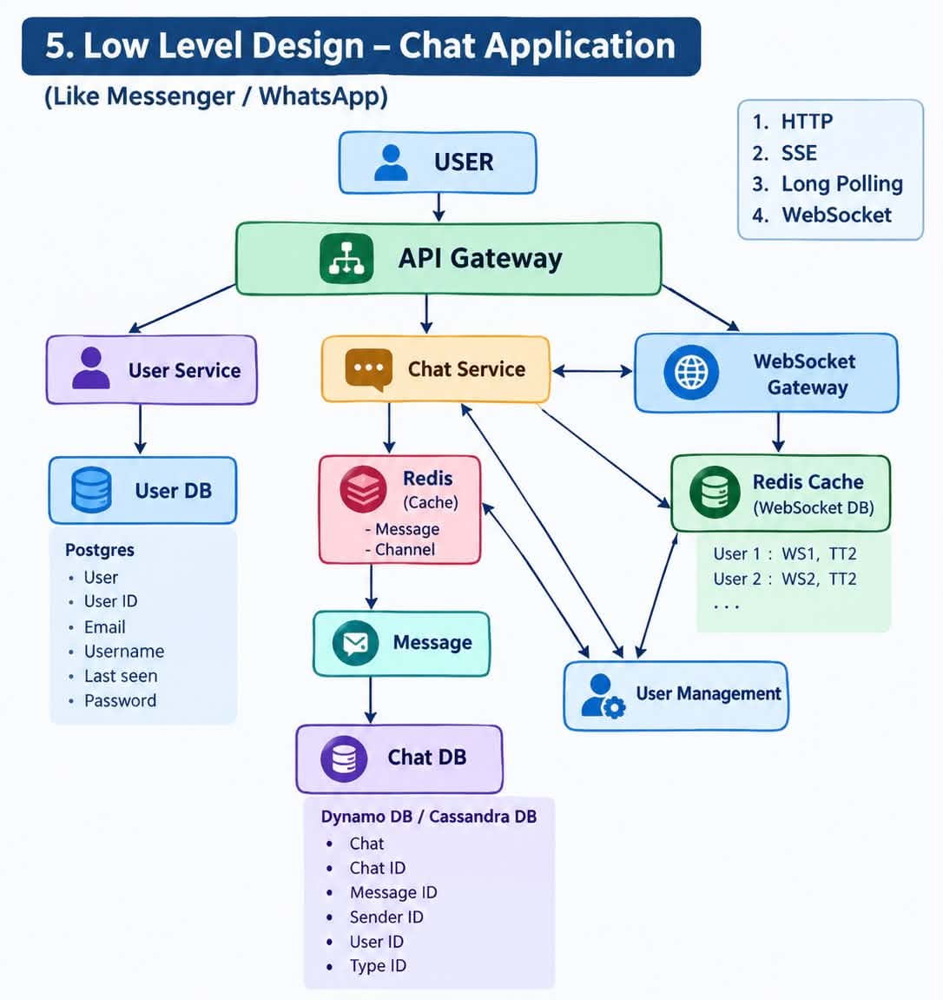

# Chat-APP – System Design

A WhatsApp-style 1:1 messaging system designed to serve 10M users and 1000M+ messages, with support for audio/video sharing and delivery/read receipts. Availability is prioritised over consistency.


## 1. Requirement Analysis

### A. Functional Requirements

- Login (register, login, logout)
- 1:1 messaging
- See all messages (chat history)
- Send audio and video
- Delivery and read receipts

### B. Non-Functional Requirements

| Requirement | Target |
|---|---|
| Scale | 10M users, 1000M+ messages |
| CAP theorem | Availability >>>>>>>>>> Consistency |
| Latency | Real-time delivery for online users |
| Durability | Messages must never be lost once accepted |
| Ordering | Messages are ordered within a single chat |

## 2. Identifying Entities

| Entity | Description | Key Fields |
|---|---|---|
| **User** | A registered person using the app | `user_id`, `name`, `phone/email`, `password_hash`, `created_at` |
| **Chat** | A 1:1 conversation between two users | `chat_id`, `user_a`, `user_b`, `last_message_at` |
| **Message** | A single text/audio/video message in a chat | `message_id`, `chat_id`, `sender_id`, `receiver_id`, `type`, `content/media_url`, `status`, `created_at` |


## 3. API Design

### A. Login


```
POST /v1/resgister={userID}->login/logout 
```


### B. Send 1:1 Message (real-time)

```
WS /v1/message/send
```

### C. See All Chats

```
GET /v1/chat/{userID}?cursor=<token>&limit=20
```


### D. Show Messages

```
GET /v1/message?userID={userID}&receiverID={receiverID}&cursor=<token>&limit=50
```

### E. Send Messages

```
WS /v1/message/send
```


### F. Media Upload (audio / video)

```
POST /v1/media/upload
```


## 4. High Level Design

```
user -> api gateway -> server ( user , chat ) -> database
```


## 5. Low Level Design



