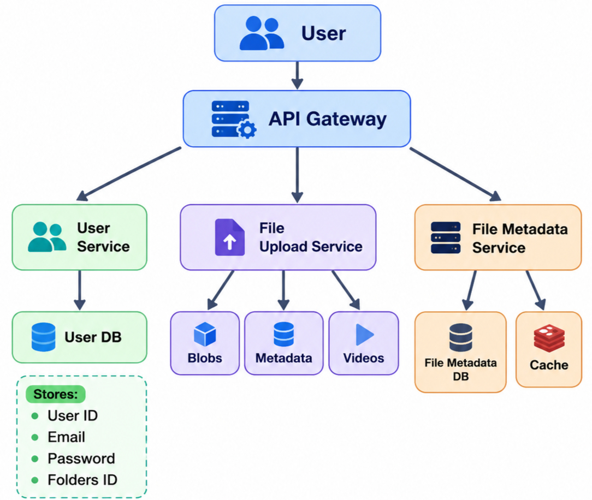

# Cloud Storage (Dropbox / Google Drive style) - System Design

A system design for a cloud file storage service where users can create an account, upload files and folders, keep devices in sync, share files with a link, and delete data. The design targets millions of users, favours availability over consistency, supports every file type, and aims for upload latency under 200 ms.


## 1. Requirement Analysis

### 1A. Functional Requirements

| # | Requirement | Description |
|---|-------------|-------------|
| 1 | Create account | Register, log in and log out securely |
| 2 | Upload files / folders | Upload single files, many files, or an entire folder tree |
| 3 | System synchronization | Changes made on one device appear on all other devices of the same user |
| 4 | Ability to share | Generate a link that lets another person download a file |
| 5 | Delete folders | Delete a file or a folder together with everything inside it |

### 1B. Non-Functional Requirements

| Requirement | Target | Design consequence |
|-------------|--------|--------------------|
| Scale | Millions of users | Stateless servers, sharded databases, object storage |
| CAP theorem | Availability >>>>> Consistency | Eventual consistency for file metadata, replicated stores |
| File support | All file types | Treat files as opaque bytes, no type restrictions |
| Upload latency | < 200 ms | Client uploads chunks directly to object storage using pre-signed URLs, so the API only handles small metadata requests |


## 2. Identifying Entities

| Entity | Purpose | Key fields |
|--------|---------|-----------|
| **User** | A person who owns an account and storage quota | userID, name, email, passwordHash, quota |
| **Files** | A file or a folder owned by a user (a folder is a file with `isFolder = true`) | fileID, userID, parentID, name, size, checksum, version, shareToken, deleted |


## 3. API Design

| ID | Purpose | Method and path | Request | Response |
|----|---------|-----------------|---------|----------|
| 3A | Create account / login / logout | `POST /v1/account/user` | `{ action: register / login / logout, name, email, password }` | `201` created, or `200` with a session token |
| 3B | Upload files / folders | `POST /api/v1/user={userID}/upload/{folderID}` | multipart form: files and their relative paths | `201` with saved file IDs |
| 3C | Sync | `POST /v1/{userID}/sync` | `{ cursor }` last change the device has seen | `200` with the list of changes and a new cursor |
| 3D | Share URL | `GET /v1/files/uploads/chunk-url/{uploadID}` | none (the ID is in the path) | `200` with a signed URL |
| 3E | Delete | `PUT` or `DELETE /v1/files/{fileID}/Delete` | none | `200` with the number of removed items |


## 4. High Level Design

```
user -> api gateway -> sever ( user , fileuploader and filemetadata ) -> database ( userDB , metadataDB, cache )

```


## 5. Low Level Design




