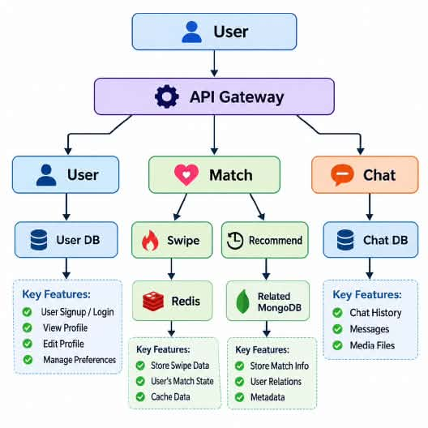

# Dating-APP

System design for a swipe-based dating app: anonymous profiles, preferences, left/right swiping, matching, chat and image upload. No login is required. Each device gets an ID and that ID is the identity.


## 1. Requirement Analysis

### Functional Requirements

* Create a profile.
* Update a profile.
* Set preferences (age, sex, location).
* Swipe left and right on recommended profiles.
* Chat with matches.
* Upload images.

### Non-Functional Requirements

* **CAP theorem:** Availability >>>> Consistency. A user should always get a response, even if a recommendation list or a swipe count is a few seconds stale.
* **Minimum latency:** swiping must feel instant, so hot data (swipes, match state, recommendation lists) is served from memory.


## 2. Identifying Entities

* **User**: identity, profile details, preferences, photos.
* **Profiles / Swipe**: recommended profiles, swipe decisions (left or right), matches.
* **Chat**: conversations between two matched users, messages and media files.


## 3. API Design


### Create Profile (login + register)

```
POST /v1/user/{ID}
```

### Update Profile

```
POST /v1/user/{ID}/update
```

### Able to Swipe (get profiles)

```
GET /v1/users/recommend?id={ID}&limit=10
```

### Record a Swipe

```
POST /v1/{ID}/swipe
```

### Upload Image

```
POST /v1/{ID}/upload
```

### Chatting

```
WS /v1/{ID}/chat
```


## 4. High Level Design

```
user -> api gateway -> server ( ) -> database ( )
```


## 5. Low Level Design



