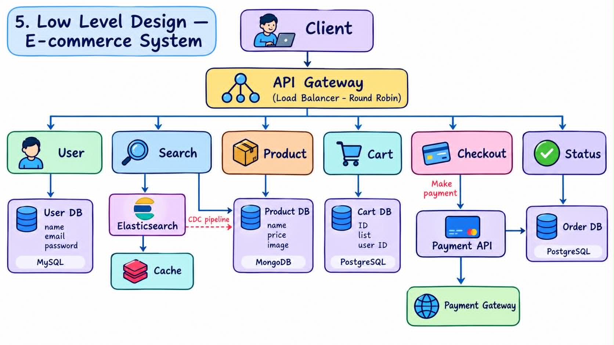

# E-Commerce Platform: System Design

A designed system for an e-commerce platform covering login, product search and view, cart, checkout, payment, and order status tracking. This repository documents the requirements, entities, APIs, and high-level and low-level design.

## 1. Requirement Analysis

### A. Functional Requirements

- Users can log in with an ID (email) and password.
- Users can search and view products.
- Users can add products to a cart and place an order.
- Users can complete payment and checkout.
- Users can check the status of an order.

### B. Non-Functional Requirements

| Category       | Requirement                                              |
|----------------|----------------------------------------------------------|
| Scale          | 10 million daily active users (DAU), 10 orders/second    |
| Availability   | Highly available; no single point of failure             |
| Latency        | Product search latency < 200 ms                          |


## 2. Entities

- **User**: account credentials and profile
- **Product**: catalog item with details, price, and stock
- **Cart**: the set of products a user intends to buy
- **Order**: a confirmed purchase with status
- **Checkout**: the step that converts a cart into an order and triggers payment


## 3. API Design


### A. Search

```http
GET /v1/search?query={search}&page={n}&size={n}
```

Returns a paginated list of product IDs.

```json
{
  "productIds": ["p_101", "p_102", "p_103"],
  "page": 1,
  "size": 10,
  "total": 254
}
```

### B. View Product

```http
GET /v1/product/{productId}
```

Returns product details.

```json
{
  "id": "p_101",
  "name": "Wireless Headphones",
  "price": 49.99,
  "currency": "USD",
  "stock": 120,
  "description": "..."
}
```

### C. Cart

```http
POST /v1/cart
Content-Type: application/json

{ "productIds": ["p_101", "p_102"] }
```

### D. Checkout and Payment

```http
POST /v1/checkout
Content-Type: application/json

{ "productIds": ["p_101", "p_102"] }
```

Response: `{ "orderId": "o_9001" }`

```http
POST /v1/payment
Content-Type: application/json

{ "orderId": "o_9001" }
```

Response: payment confirmation.

### E. Order Status

```http
GET /v1/status/{orderId}
```

Returns the current order state (e.g., `PENDING`, `PAID`, `SHIPPED`, `DELIVERED`).


## 4. High-Level Design

```
 User
  │
  ▼
API Gateway  (auth, rate limiting, routing)
  │
  ▼
Application Servers
  ├── Login Service
  ├── Search Service      ──► Search Index (e.g., Elasticsearch) + Cache
  ├── Product Service     ──► Product DB + Cache
  ├── Cart Service        ──► Cache / Cart Store
  ├── Checkout Service    ──► Order DB
  └── Status Service      ──► Order DB
  │
  ▼
Database Layer (primary + read replicas, sharded by user/order ID)
```


## 5. Low-Level Design


