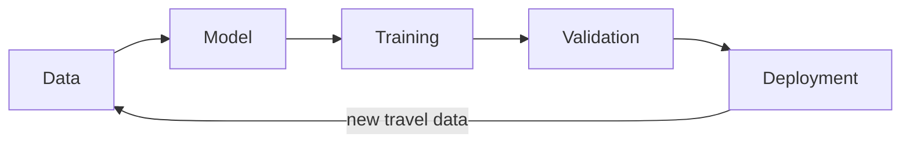
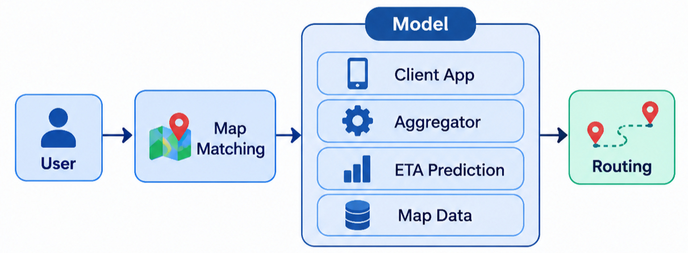

# ETA-FOR-MAP: Estimated Time of Arrival for Maps

A system design for predicting how long a trip will take on a map (the "ETA" shown in Google Maps / Apple Maps style apps), built from per-road-segment travel-time predictions.

## 1. Requirement Analysis

### Functional Requirements

- The system gives an **ETA** for a route on a map.
- Given a road segment and a time interval within the week, it returns the expected travel time.

### Non-Functional Requirements

| Concern | Requirement |
|---|---|
| Scale | 10M DAU |
| CAP theorem | **Available >>> Consistent** (a slightly stale ETA is fine, no ETA is not) |

## 2. Identifying Entities

- **User**: the person (or device) requesting a route and sending location updates.
- **Map**: the road network, made of segments (edges) and intersections (nodes).
- **ETA**: the predicted travel time for a segment or a full route.


## 3. Pipeline Design

### Interface

```python
def f(segment_id, interval_within_week) -> eta
```

### Parametrization

```
eta = f(segment_id, interval, within_week)
```

```
route_eta = sum( distance(s_i) / predicted_speed(s_i, interval_i) )
```


## 4. High-Level Design



| Step | What happens |
|---|---|
| **a. Data** | Make sure map data and travel data are clean and usable for training. |
| **b. Model** | Parametrization: predict speed (or travel time) per `(segment_id, interval_within_week)`. |
| **c. Training** | Choose features: segment attributes, interval, historical average speed, recent live speed. |
| **d. Validation** | Train/test split (split by time, not randomly, so the test set is the "future"). |
| **e. Deployment** | Serve the model in the product behind the ETA API; retrain on a schedule. |

## 5. Data Model

### Map (static, changes rarely)

| Field | Type | Notes |
|---|---|---|
| `segment_id` | BIGINT (PK) | Unique road segment |
| `distance` | FLOAT | Segment length in meters |
| `speed_limit` | INT | km/h |
| `free_flow_speed` | FLOAT | Speed with no traffic, km/h |

### Travel (large, append-heavy)

| Field | Type | Notes |
|---|---|---|
| `year` | INT | Year of the observation |
| `num_car` | INT | Number of cars observed in the interval |
| `avg_speed` | FLOAT | Average speed in the interval, km/h |
| `interval` | INT | Bucket within the year / week |
| `segment_id` | BIGINT (FK) | Links the observation to a Map segment |


## 6. Low-Level Design


