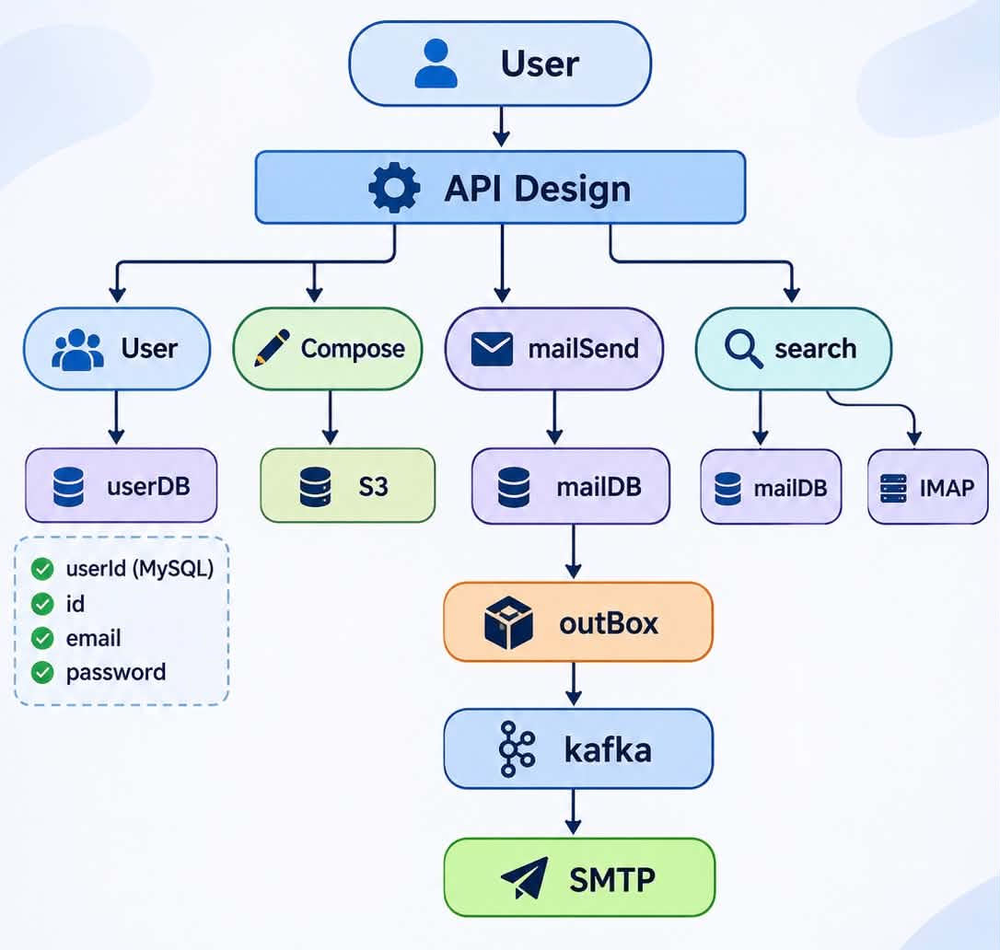

# 📧 Email-Delivery — System Design

A system design for a large-scale email platform (Gmail-style): users register, compose and send emails with attachments, view a dashboard summary, and search their mailbox. The design targets 100M users and 1 billion emails, and prefers availability over consistency.


## 1. Requirement Analysis

### Functional Requirements

| # | Requirement | Description |
|---|-------------|-------------|
| 1 | User onboarding | Register, login, logout |
| 2 | Send email | Send to `to`, `cc`, `bcc` with subject, body, and attachments |
| 3 | View dashboard | See a summary of the mailbox (inbox, sent, unread counts, recent mails) |
| 4 | Search mails | Search by keyword, sender, subject, etc. |

### Non-Functional Requirements

| Requirement | Target |
|-------------|--------|
| Scale | 100M users, 1 billion emails |
| CAP theorem | Availability >>>> Consistency (AP system) |
| Durability | A sent email must never be lost |
| Latency | Send API acknowledges fast (async delivery); search results in under a second |
| Scalability | Horizontally scalable at every layer |

---

## 2. Identifying Entities

| Entity | Purpose | Key fields |
|--------|---------|------------|
| **User** | Account holder | `userId`, `email`, `password` (hashed) |
| **Email** | A single message | `emailId`, `from`, `to`, `cc`, `bcc`, `subject`, `body`, `attachments`, `status`, `timestamp` |
| **Conversation Metadata** | Threading and mailbox state | `conversationId`, `emailIds`, `labels`, `readStatus`, `lastUpdated` |


## 3. API Design

### 3.1 Onboarding

```http
POST /v1/accounts/register
POST /v1/accounts/login
POST /v1/accounts/logout
```

**Register request**

```json
{
  "email": "user@example.com",
  "password": "********"
}
```

### 3.2 Send Email

```http
POST /v1/email/{userID}/send
```

```json
{
  "to": "...",
  "bcc": "...",
  "cc": "...",
  "subject": "...",
  "body": "...",
  "attachment": "..."
}
```

- Returns `202 Accepted` since delivery is asynchronous (outbox, Kafka, SMTP).
- Send an `Idempotency-Key` header so client retries do not create duplicate emails.

### 3.3 Dashboard

```http
GET /v1/emails/summary
```

### 3.4 Search Mail

```http
GET /v1/search?query={query}
```


## 4. High Level Design

```
User → API Gateway → Server(s) → Database(s)
```


## 5. Low Level Design




