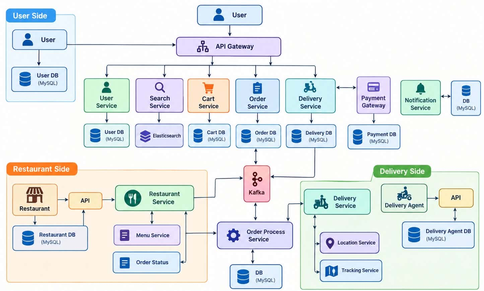

# Food Delivery System Design (Zomato / Swiggy / Uber Eats style)

A complete system design for an online food-delivery platform: requirements, entities, APIs, high-level design, low-level design, database choices, and trade-offs.


## 1. Requirement Analysis

### A. Functional Requirements

| # | Feature | Description |
|---|---------|-------------|
| 1 | Login / Logout | User registers, logs in, and logs out securely |
| 2 | Show nearby restaurants | List restaurants based on the user's location (paginated) |
| 3 | Search | Search restaurants or dishes by name, cuisine, etc. |
| 4 | View menu | See food items, prices, and availability of a restaurant |
| 5 | Cart | Add, update, and remove items before ordering |
| 6 | Payment | Pay for the order securely |
| 7 | Order status | Track the order: placed → accepted → preparing → picked up → delivered |
| 8 | Delivery | Assign a delivery agent and track live location |

### B. Non-Functional Requirements

| Requirement | Target |
|-------------|--------|
| Scale | **100M MAU** (monthly active users) |
| CAP theorem | **Available** for search and browsing, **Consistent** for payment and orders |
| Latency | Search and restaurant listing should feel instant (low hundreds of ms) |
| Durability | Orders and payments must never be lost |
| Security | Authenticated APIs, secure payment handling |


## 2. Identifying Entities

| Entity | Role |
|--------|------|
| **User** | Customer who searches, orders, and pays |
| **Restaurant** | Owns a menu, receives and prepares orders |
| **Delivery Agent** | Picks up the order and delivers it, shares live location |

## 3. API Design

A. login 
POST /v1/user/register={userid,metadetails}->login/logout
B. Show 
GET /v1/results={restaurant ={location}}->  List<restaurantID> :pagenation 
C. Search
GET /v1/search?query={search}-> List<restaurantID> :pagenation 
D. View Menu
GET /v1/restaurant={restaurantID} -> food items details 
D. Order Book 
POST /v1/book{book body :restaurantID}-> bookID
E. Cart 
POST /v1/cart/items-> cartID
F. Payment 
POST /v1/payment={bookID} -> paymentID 
G. Status 
GET /v1/delivery/{orderID}/tracking

## 4. High-Level Design (HLD)

```
User → API Gateway → Services (Search, View, Book, Payment) → Database
```
## 5. Low-Level Design (LLD)


