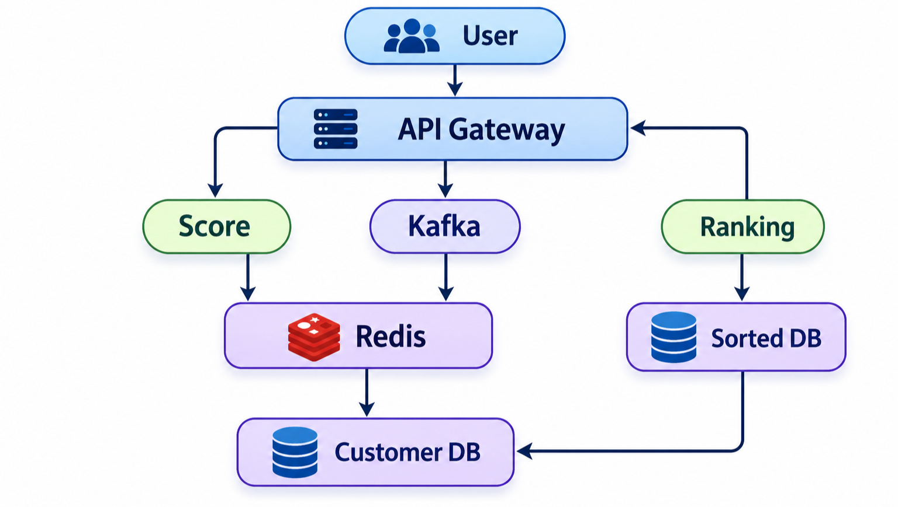

# Game Leaderboard: System Design

A real-time global leaderboard that accepts score uploads from players, serves the Top-K list for a chosen time window, and tells any player their current rank, all at 1M requests/sec with availability favoured over consistency.

## 1. Requirement Analysis

### 1A. Functional Requirements

| # | Requirement | Meaning |
|---|-------------|---------|
| 1 | Upload data | A user (game client or game server) can submit a score. |
| 2 | Query Top-K | Anyone can fetch the top K players, with pagination. |
| 3 | Time period selection | Leaderboards can be viewed per window: hour, day, week, month, all-time. |
| 4 | Real-time updates | A new score appears on the board within about a second, without a manual refresh. |

### 1B. Non-Functional Requirements

| Requirement | Target | Why it matters |
|-------------|--------|----------------|
| Scale | **1M requests/sec** | Score writes and leaderboard reads arrive in huge bursts (events, tournaments, new releases). |
| CAP theorem | **Availability >>>>> Consistency** | A leaderboard that is a second stale is fine. A leaderboard that is down is not. |
| Latency | Low (tens of ms) for reads | Ranks are shown live in the game UI. |
| Durability | Scores must never be lost once accepted | Players care about their best score. |


## 2. Identifying Entities

| Entity | Description | Key attributes |
|--------|-------------|----------------|
| **User** | A player. | `user_id`, `name`, `country` |
| **Score** | One score submission (an event). | `event_id`, `user_id`, `leaderboard_id`, `score`, `timestamp` |
| **Time frame** | The window used to filter and rank scores. | `hour`, `day`, `week`, `month`, `all` |


## 3. API Design

### 3A. Upload Data

```http
POST /v1/scores
```

### 3B. Query Top-K

```http
GET /v1/leaderboard/{leaderboardID}/top?k={limit}&window={window}&offset={offset}
```

### 3C. Rank of a Single User (Real-Time)

```http
GET /v1/leaderboard/{leaderboardID}/rank/{userID}?window={window}
```

## 4. High Level Design

```
User -> API Gateway -> Servers (Score + Ranking) -> Databases (Customer DB, Score / Sorted DB)
```


## 5. Low Level Design



