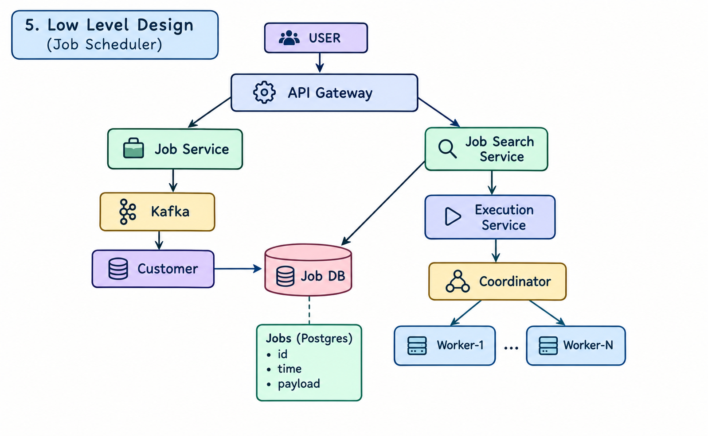

# Job Scheduler: System Design

A distributed job scheduler that lets users create a job, monitor its status, and cancel it before it runs. It is designed for 10,000 job submissions per second, and it prefers availability over consistency ( CAP Theorem ).

## 1. Requirement Analysis

### A. Functional Requirements

- Create / schedule a job
- Maintain / monitor the status of a job
- Cancel a scheduled job

### B. Non-Functional Requirements

| Requirement | Target |
|---|---|
| Scale | 10k jobs per second |
| CAP theorem | Availability is much more important than consistency (AP system) |
| Durability | An accepted job must never be lost |
| Execution guarantee | At-least-once (jobs must be idempotent) |
| Latency | Job creation API should respond quickly; it only needs to accept and persist the job |


## 2. Entities

| Entity | Description |
|---|---|
| **Job** | The unit of work: id, payload, scheduled time, status |
| **Schedule** | When the job should run (one-time at a given timestamp; recurring with a cron expression can be added later) |
| **Executor** | The component that runs the job (Execution Service, Coordinator, and Workers) |


## 3. API Design


### A. Create / Schedule a Job

```
POST /v1/api/jobs -> create a job 
```


### B. Monitor Status of a Job

```
GET /v1/api/jobs/{jobId} -> status of job details 
```


### C. Cancel a Scheduled Job

```
POST /v1/api/jobs/{jobId}/cancel -> cancel a job
```


## 5. High Level Design

```
User -> API Gateway -> Server (Job Service & Job Search Service) -> Database
```


## 6. Low Level Design



