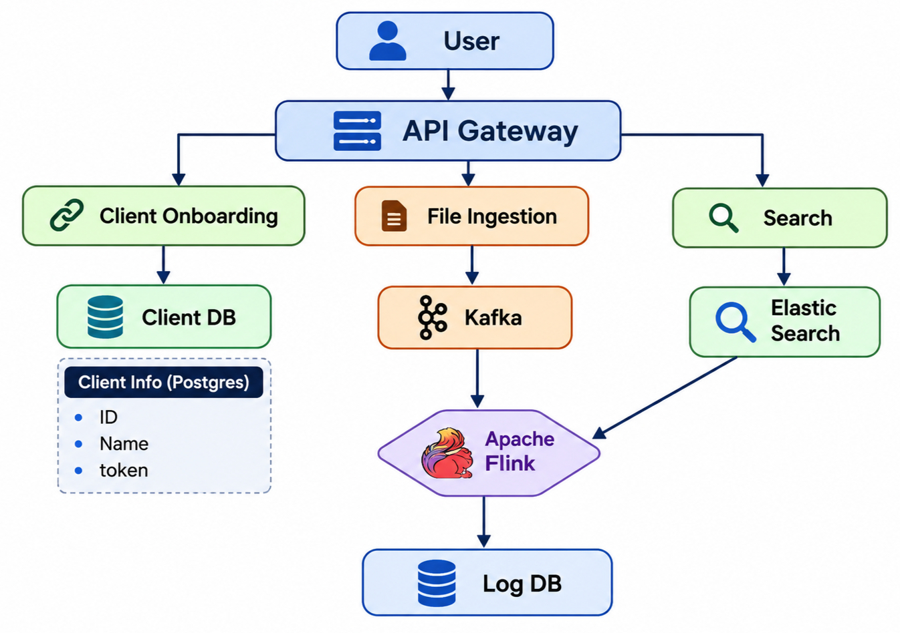

# Login System (Login Activity Platform)

A system design for a platform that collects login activity from **multiple sources**, streams it in real time , validates it, and makes it searchable. 

## 1. Requirement Analysis

### 1A. Functional Requirements

| # | Requirement | Meaning |
|---|-------------|---------|
| 1 | Login from multiple sources | Web, mobile, desktop, partner apps and backend services can all report login activity. |
| 2 | Real-time streaming | Events flow through a streaming pipeline instead of being processed in nightly batches. |
| 3 | Validate logins | Each event is checked (valid client, valid token, valid schema, suspicious patterns) before being stored. |

### 1B. Non-Functional Requirements

| Requirement | Target |
|-------------|--------|
| Scale | 10M+ users / events |
| CAP theorem | **Availability >>>> Consistency** (AP system) |
| Latency | Low, near-real-time |

## 2. Identifying Users (Actors)

| Actor | Role |
|-------|------|
| **Log Event** | A single record of activity (login, logout, register) with user ID, source, timestamp and status. |
| **Ingestion Job** | A batch or scheduled job that uploads logs in bulk (files, exports from older systems). |
| **Agent** | A lightweight client or SDK running on a source system that pushes live activity events. |

## 3. API Design

### 3A. Login Activity

```
POST /v1/agents/activity
```


```json
{
  "action": "login | logout | register",
  "userId": "u_12345",
  "source": "web | android | ios | partner",
  "timestamp": "2026-11-03T10:15:00Z"
}
```

### 3B. Search

```
POST /v1/search
```

```json
{
  "query": "userId:u_12345 AND action:login",
  "filters": { "source": "web", "from": "2026-11-01", "to": "2026-11-03" },
  "pageSize": 50,
  "cursor": "eyJ0cyI6MTc2..."
}
```

```
GET /v1/logs/{logId}
```


### 3C. Ingestion

```
POST /v1/logs
```

```json
{
  "mode": "ingest | batch",
  "logs": [ { "...": "..." } ]
}
```


## 4. High Level Design

```
user -> api gateway -> sever ( client onboarding , file ingestion and search ) -> database ( clientDB and logDB )
```

## 5. Low Level Design


