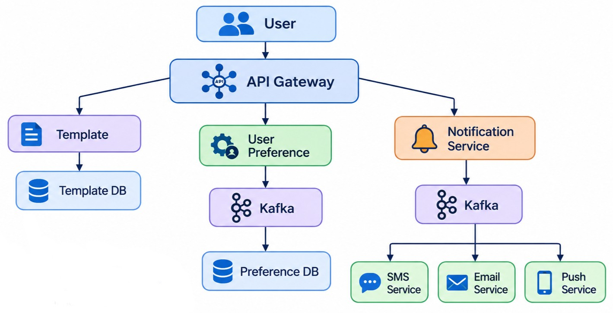

# Notification System : System Design

A scalable, highly available **multi-channel notification platform** that sends SMS, Email and Push (Android / iOS) notifications using dynamic templates and per-user preferences, with delivery-status reporting.


## 1. Requirement Analysis

### 1A. Functional Requirements

- Support multiple client systems / platforms (**Android, iOS**) and multiple channels (**SMS, Email, Push**).
- Create **dynamic templates** (a template with placeholders such as `{{name}}`, `{{otp}}`, filled in at send time).
- **Reporting** – track whether a notification was queued, sent, delivered or failed.
- Respect **user preferences** (which channels a user wants, opt-in / opt-out).

### 1B. Non-Functional Requirements

| Concern | Requirement |
|---|---|
| **Scale** | 1M notifications |
| **CAP Theorem** | Availability >>>>> Consistency (AP system) |
| **Latency** | ~200 ms for the API to accept a notification request |


## 2. Identifying Entities

| Entity | Description |
|---|---|
| **User** | The person receiving notifications; owns channel preferences and device tokens. |
| **Template** | Reusable message body with placeholders; versioned. |
| **Client** | The calling application / platform (Android app, iOS app, backend service) that triggers notifications. |


## 3. API Design

### 3A. Notification

| Method | Endpoint | Purpose |
|---|---|---|
| `POST` | `/v1/notification` | Submit a notification request (`templateId`, `userId`, `clientId`, template variables) |
| `GET` | `/v1/notification/{id}/status` | Fetch delivery status of a notification |

```http
POST /v1/notification
Idempotency-Key: 7f3c...

{
  "clientId": "android-app",
  "userId": "u_101",
  "templateId": "t_otp",
  "variables": { "name": "Saurab", "otp": "482913" }
}
```
```json
202 Accepted
{ "notificationId": "n_9001", "status": "QUEUED" }
```

### 3B. Template

| Method | Endpoint | Purpose |
|---|---|---|
| `POST` | `/v1/templates` | Create a template (or a new version of it) |
| `GET` | `/v1/templates/{id}/version` | Fetch template version(s) |

### 3C. User Preference

| Method | Endpoint | Purpose |
|---|---|---|
| `PUT` | `/api/v1/preference/{clientId}` | Set / replace the user's channel preferences for a client |

```json
{
  "userId": "u_101",
  "sms": false,
  "email": true,
  "push": true
}
```

## 4. High Level Design

```
user -> api gateway -> sever ( templates , user preferences & notfication srver ) -> database ( clientDB, templatesDB , SMSDB , emailDB & pushDB )
```


## 5. Low Level Design



