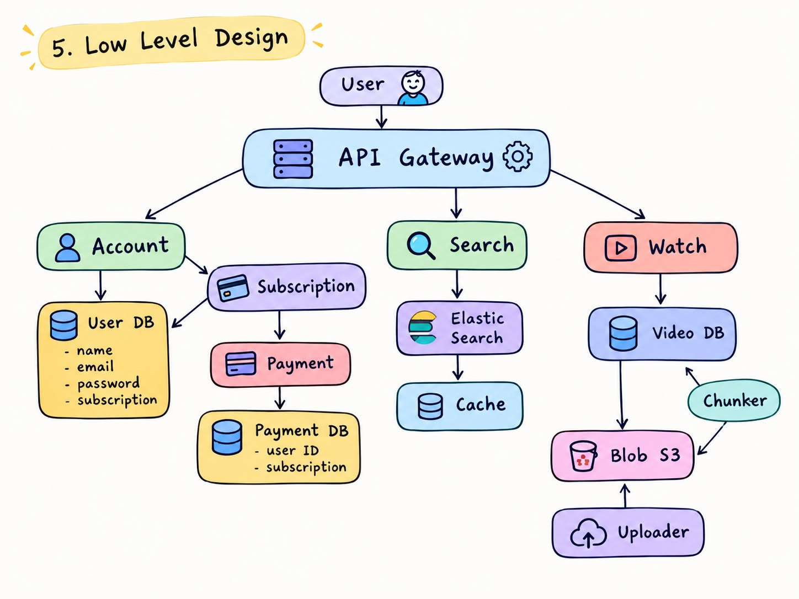

# OTT Platform: System Design

A Netflix-style OTT (over-the-top) streaming platform, designed end to end (requirements → entities → API → high-level design → low-level design) and implemented as a single- ile Flask demo called **StreamGate** (`OTT-Platform.py`).


## 1. Requirement Analysis

### A. Functional Requirements

- Create an account (register, login, logout)
- Subscribe to different plans
- Search and view TV shows
- Watch TV shows

### B. Non-Functional Requirements

| Concern | Target |
|---|---|
| Scale | 100M MAU, 10k videos |
| Availability | Favour availability over consistency for browsing/streaming (CAP theorem, see [section 8](#8-cap-theorem-decisions)) |
| Search latency | < 2 ms |


## 2. Identifying Entities

| Entity | Key fields |
|---|---|
| **User** | `id`, `name`, `email`, `password` (stored hashed), `subscription` |
| **Video** | `id`, `title`, `genre`, `description`, `cast`, `year`, `duration`, `tier`, `blob key`, `chunks` |


## 3. API Design


A. Account Creation 
POST /v1/user/regoster + login/logout -> confirmation 
B. Subscrption
GET /v1/subscrption/plan-> detaiils
C. search videos
GET /v1/search?query={search}-> List<videoID> :pagenation 
D. View Videos
GET /v1/video={videoD} -> video details 
E. Watch Videos
GET /v1/videos/play={videoID}-> video play

## 4. High-Level Design

```
User → API Gateway → Services (Account, Subscription, Search, Watch) → Databases
```

## 6. Low-Level Design

]


## KeyPoints : 
## When to Use GET vs POST

### The rule of thumb

| | **GET** | **POST** |
|---|---|---|
| Intent | **Read** data | **Create / change** state or trigger an action |
| Changes server state? | No (safe) | Yes |
| Idempotent? | Yes, repeating gives the same result | No, repeating may create duplicates or charge twice |
| Where data goes | URL (path + query string) | Request body (JSON / multipart) |
| Cacheable by browser / CDN / gateway? | Yes | Generally no |
| Safe for secrets (password, card)? | **No**: URLs end up in logs, history, proxies | **Yes**: body is not logged by default |
| Bookmarkable / shareable? | Yes | No |

## Cap Theorem 

Tradeoff Of Availability And Consistency
