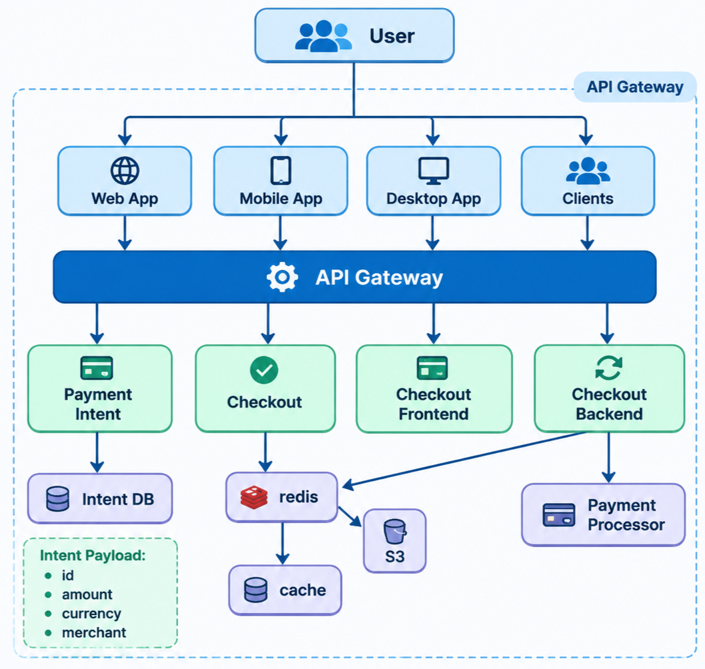

# Payment-Gateway

A system design for a payment gateway: a service that sits between a merchant (client) and the card networks/banks, accepts a payment request, lets the customer pay through a short-lived secure session, and reports the final status of the payment.


## 1. Requirement Analysis

### 1A. Functional Requirements

| # | Requirement | Meaning |
|---|-------------|---------|
| 1 | Client should initiate a payment request | A merchant/client tells the gateway *what* to charge (amount, currency, merchant) |
| 2 | Gateway creates a temporary session to use the card | Card details are collected only inside a short-lived, single-purpose session |
| 3 | Secured data handling | Card data is never stored in plain text and never touches the merchant's servers |
| 4 | Status tracking | Client can check whether a payment is pending, successful, or failed |

### 1B. Non-Functional Requirements

| Requirement | Target | Why it matters |
|-------------|--------|----------------|
| Scale | **10K TPS** | Peak transaction throughput the gateway must sustain |
| CAP Theorem | **Consistency >>>>> Availability** | Money must never be double-charged or lost; refusing a request is better than a wrong answer |
| Nominal latency | **200 ms** | A customer is waiting on a checkout screen |


## 2. Identifying Entities

| Entity | Description |
|--------|-------------|
| **Client** | The merchant or application that integrates with the gateway and requests payments |
| **Users** | The end customers who pay using their card |
| **Payment** | The payment intent: what is to be paid (ID, amount, currency, merchant, status) |
| **Transaction** | The actual attempt to move money, produced at checkout (attempt result, processor reference, timestamps) |


## 3. API Design

### 3A. Payment Request: `POST /v1/payment-intent`

### 3B. Session Creation: `POST /v1/payment-session`

### 3C. Checkout: `POST /v1/checkout/pay`

### 3D. Status Tracking: `GET /v1/payment/{paymentId}`


## 4. High Level Design

```
User
  |
  v
API Gateway
  |
  v
Server  ( Payment Intent + Checkout )
  |
  v
Database  ( Client DB + Payment DB )
```


## 5. Low Level Design




