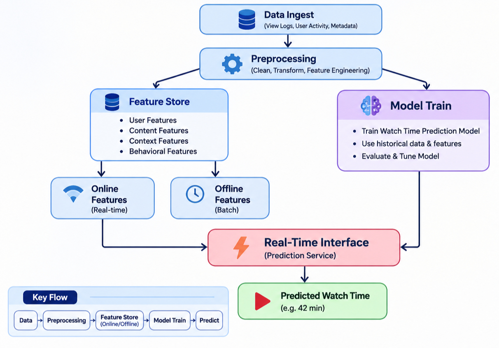

# Predict Netflix Watch Time

A system design for predicting how long a user will watch a movie / TV show next, so that recommendations, row ordering, and content promotion can be tuned around expected engagement.


## 1. Requirement Analysis

### Functional Requirements

| # | Requirement |
|---|-------------|
| F1 | Predict the **next watch time** of a user for a movie / TV show. |
| F2 | **Customizable** system for recommendations (tune weights, filters, model version, per-user preferences). |
| F3 | **Acknowledge behavioural change** (user taste shifts, new device, new season, binge phase, etc.). |

### Non-Functional Requirements

| Attribute | Target |
|-----------|--------|
| Scale of users | **10M DAU** |
| Scale of data | **10 million** data records (watch-time dataset) and growing |
| CAP theorem | **Availability >>> Consistency** (a slightly stale prediction is fine; no prediction is not) |

## 2. Capacity Estimation

> These are working assumptions, adjust them to your real traffic.

| Item | Assumption | Result |
|------|-----------|--------|
| Daily active users | 10M | |

## 3. Identifying Entities

| Entity | Description |
|--------|-------------|
| **User** | The viewer: profile, history, preferences, device, region. |
| **Platform** | The Netflix-style platform: content catalog, devices, app surfaces, events it emits. |
| **Model** | The trained predictor: version, features used, metrics, deployment state. |

## 4. Pipeline Design

- **Unsupervised Learning** is used to learn user and content representations (embeddings, clusters of viewing behaviour, behavioural-shift detection).

## 5. High-Level Design

### 5a. Data Set: Watch Time DB

| Group | Events / Fields |
|-------|-----------------|
| **Content: Impression** | Content shown to the user (row, position, device, time) |
| **Play** | `Start`, `Pause`, `Resume`, `Stop` |
| **Content outcome** | `Skip`, `Played`, `Left`, `Ignored` |

### 5b. Feature Engineering

| Group | Examples |
|-------|----------|
| **User** | Avg session length, preferred genres, preferred time of day, device type, region, recent binge streak, last-N watched titles |
| **Content** | Genre, runtime, release year, language, maturity rating, popularity, avg completion rate, episode count |
| **Context (X)** | Time of day, day of week, device, network, holiday / season, position in row |
| **Behavioural** | Recent vs long-term watch ratio, skip rate in the last 7 days, genre drift score |

### 5c. Target

```
T̂ = f(U, C, X)
T̂ = Σ (watched)
```

Where:

- **U** = User features
- **C** = Content features
- **X** = Context / other features
- **T̂** = predicted watch time (sum of watched time)


## 6. Low-Level Design



