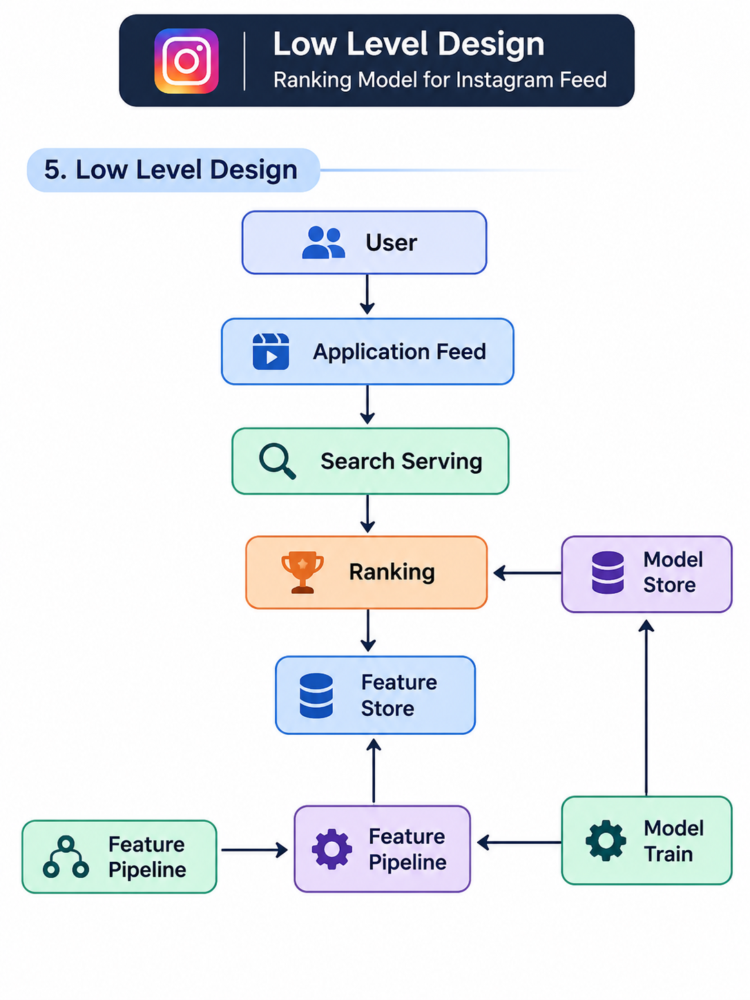

# Ranking Model for Instagram Feed

> Low-level system design of an ML-driven feed ranking system: Candidate Generation → Ranking → Post-Processing.


## 1. Requirement Analysis

### Functional Requirements

- Suggest posts from content creators to each user.
- The ML model must be aligned with business goals (engagement, retention, creator health), not just raw clicks.
- Users can view content, engage with it, like it, and comment on it.

### Non-Functional Requirements

| Requirement | Target |
|---|---|
| Scale | 10M Daily Active Users (DAU) |
| CAP theorem | Availability >>> Consistency |
| Feed latency | p99 under 300 ms (assumption) |
| Freshness | New posts and new engagement signals visible within seconds to minutes |
| Model refresh | Retrained on a schedule (for example daily) and deployed without downtime |


## 2. Identifying Entities

| Entity | Description |
|---|---|
| **User** | The viewer who opens the feed and also produces engagement signals (view, like, comment). |
| **Platform** | The system that serves, ranks, and learns from interactions (feed service, ranking, pipelines). |
| **Content** | Posts created by creators (image, video, reel, caption, metadata). |


## 3. Pipeline Design

```
Candidate Generation  →  Ranking  →  Post Processing
```

| Stage | Purpose | Output size (assumption) |
|---|---|---|
| **Candidate Generation** | Cheaply narrow millions of posts down to a few hundred relevant ones (followed creators, similar interests, trending). | about 500 posts |
| **Ranking** | ML model scores every candidate using user, content, and context features. | about 500 scored posts |
| **Post Processing** | Apply business rules: diversity, dedupe, remove already-seen posts, blocked or reported content, creator spread, ads and safety filters. | about 20 to 50 posts |

## 4. High-Level Design

```
       User
         |
         v
      Feed View
         |
         v
       Content
         |
         v
     Content DB
```

## 5. Low-Level Design

