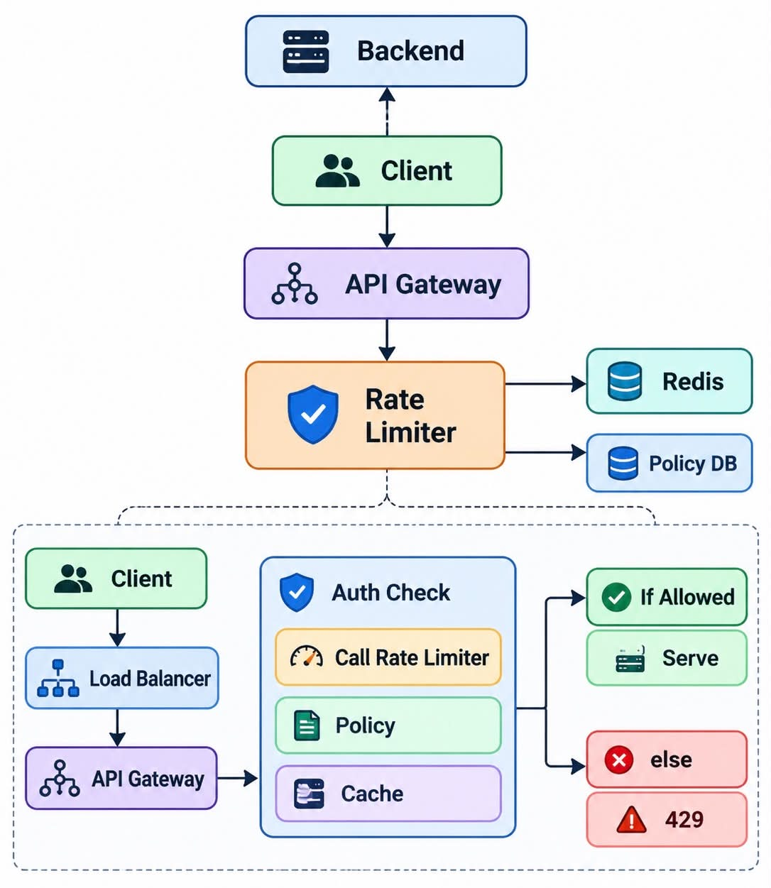

# Rate Limiter : System Design

A rate limiter controls how many requests a client can make to a service in a given time window. When a client exceeds its quota, the request is rejected with HTTP 429 Too Many Requests. It protects backend services from abuse, accidental overload, and noisy neighbours, and keeps the system fair for everyone.

## 1. Requirement Analysis

### Functional Requirements

- Limit the number of requests a client can make.
- Support configurable **rules** for rate limiting (per user, per IP, per API key, per endpoint).
- Return **429 Too Many Requests** when the limit is exceeded.
- Handle **burst** requests gracefully (short spikes should not be punished if the average rate is fine).

### Non-Functional Requirements

| Concern | Target |
|---|---|
| Scale | 10K requests per second |
| CAP theorem | Availability >>> Consistency (AP system) |
| Latency | Ultra low (the check must add only a few milliseconds) |


## 2. Identifying Entities

| Entity | Description |
|---|---|
| **User** | The client being limited. Identified by userId, API key, or IP address. |
| **Rules** | Configuration that says how many requests are allowed in what window, for which client and endpoint. Created by an admin. |
| **Request Counter** | Live state that tracks how many requests a client has made in the current window (or how many tokens are left). |


## 3. API Design

### Admin API: create a rule

```
POST /v1/admin/{adminId}/rules
```

### Rules API: read the configured rules
```

GET /v1/admin/rules/rate-limit
```

### Rate limit check API: returns 429 when limit is exceeded

```
GET /v1/rules/rate-limit?req=4993
```


## 4. High Level Design

```
user -> api gateway -> server -> database
```

## 5. Low Level Design



