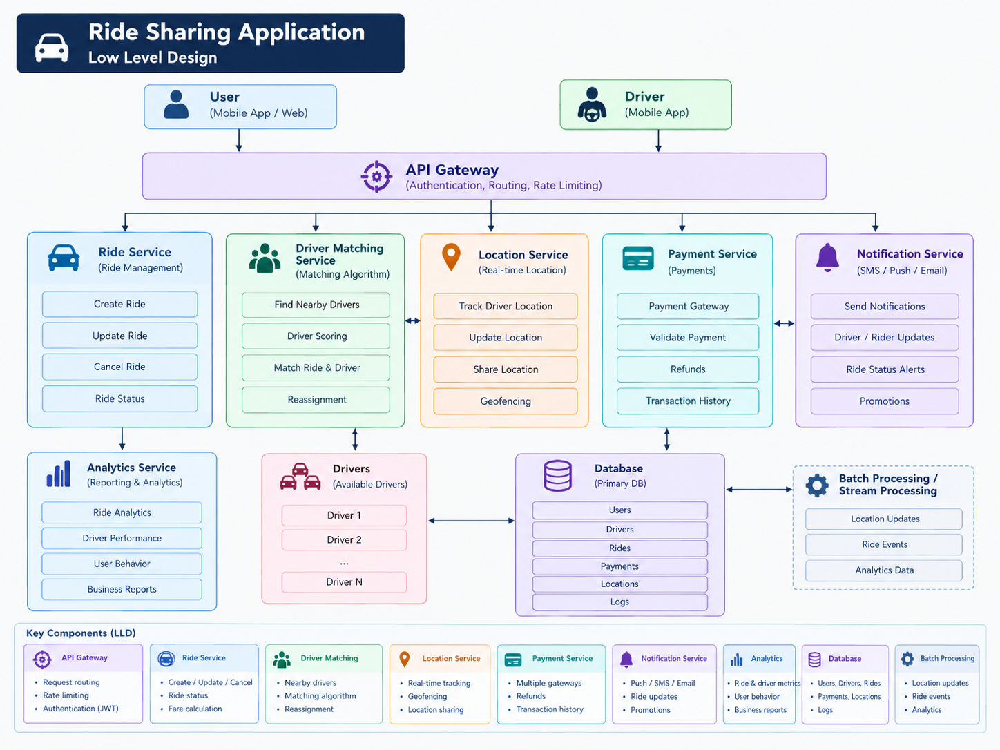

# Ride Sharing Platform (Uber-style) — System Design

A system design for a ride-sharing platform that supports fare estimation, ride requests, driver matching, real-time tracking and payments, built for 10M riders and 20K drivers.

## 1. Requirement Analysis

### 1A. Functional Requirements

- Rider can get a **fare estimate** based on pickup and drop location.
- Rider can **request a ride**.
- Rider can **choose a ride category** (e.g. Bike, Economy, Premium).
- Driver can **accept or decline** a ride request.
- System performs **rider-to-driver matching**.
- **Real-time tracking** of rider and driver.
- Rider can **pay** for the ride.

### 1B. Non-Functional Requirements

| Requirement | Target |
|---|---|
| Scale | 10M users + 20K drivers |
| Rider side | **Highly Available** (AP) — a rider should always be able to open the app, see fares, view history |
| Driver side | **Strongly Consistent** (CP) — a driver must never be assigned two rides, a ride must never be accepted by two drivers |
| Latency | Matching in a few seconds, location updates visible in under 1–2 seconds |
| Durability | Rides and payments must never be lost |


## 2. Core Entities

| Entity | Key Fields |
|---|---|
| **Rider** | rider_id, name, phone, rating, payment_method |
| **Driver** | driver_id, name, vehicle, category, status (OFFLINE / AVAILABLE / ON_RIDE), rating |
| **Fare** | fare_id, request_id, category, estimated_price, distance, eta, surge_multiplier, expires_at |
| **Ride** | ride_id, rider_id, driver_id, pickup, dropoff, category, status, fare, start_time, end_time |


## 3. API Design

### 3A. Rider Side

| Purpose | Method and Endpoint | Notes |
|---|---|---|
| Fare estimation | `GET /v1/api/fares?pickup={lat,long}&dropoff={lat,long}` | Returns `List<Fare>` (one per category) with a `requestId` |
| Request a ride | `POST /v1/api/rides/request` body: `{ requestId, category }` | Creates a Ride, starts matching |
| Ride details | `GET /v1/api/rides/{rideId}` | Status, driver info, ETA |
| Ride history | `POST /v1/api/rides/history` (as designed) | See improvement note below |
| Cancel ride | `POST /v1/api/rides/{rideId}/cancel` | State change, not idempotent by nature |
| Pay for ride | `POST /v1/api/payments` body: `{ rideId, method, idempotencyKey }` | Needs idempotency key |


### 3B. Driver Side

| Purpose | Method and Endpoint | Notes |
|---|---|---|
| Live location | `WS /v1/driver/location` | Persistent WebSocket, one message every ~4 seconds |
| Accept ride | `POST /v1/api/rides/{rideId}/accept` | Must be strongly consistent (first accept wins) |
| Decline ride | `POST /v1/api/rides/{rideId}/decline` | Triggers re-matching with next driver |
| Start ride | `POST /v1/api/rides/{rideId}/start` | Moves status to IN_PROGRESS |
| End ride | `POST /v1/api/rides/{rideId}/end` | Moves status to COMPLETED, triggers payment |


## 5. High Level Design

```
 Rider App ─┐
            ├──> API Gateway ──> Application Servers ──> Databases
 Driver App ┘   (auth, routing,    (Rider services +      (Ride DB, Payment DB,
                 rate limiting)     Driver services)       Redis, etc.)
```


## 6. Low Level Design


