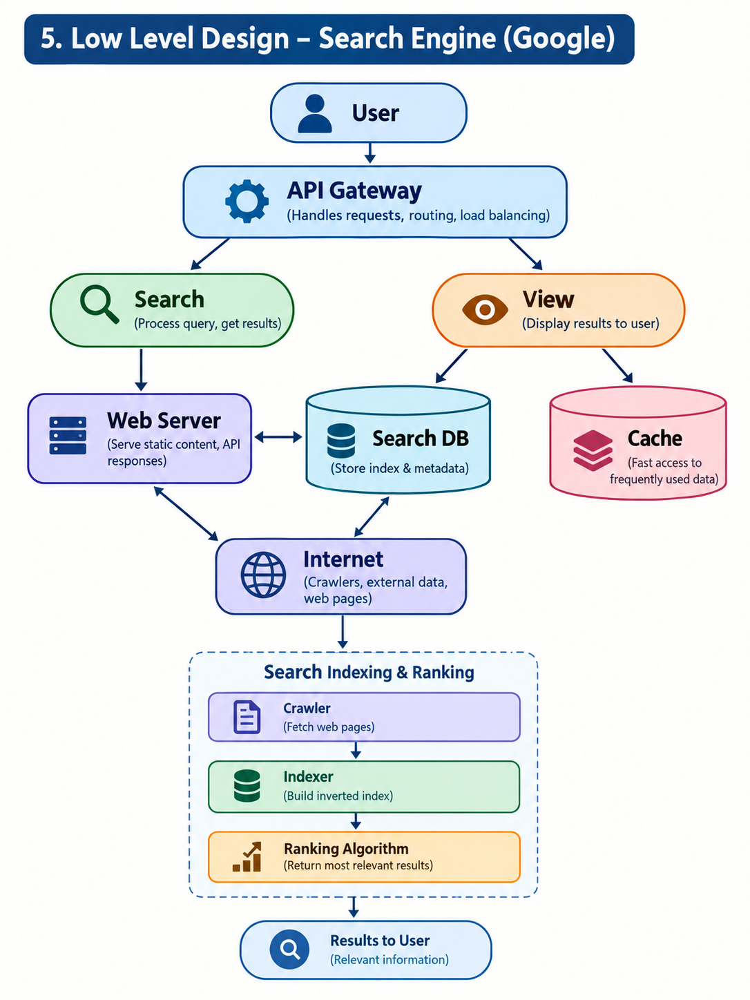

# Search Engine (Google-style) : System Design

A system design for a web search engine where a user can **search the internet** and **view results**. No login, no history. Availability is prioritised over consistency.

## 1. Requirement Analysis

### A. Functional Requirements
- Search the internet using a keyword / query
- View result pages (site details) from the internet

### B. Non-Functional Requirements
| Concern | Target |
|---|---|
| Scale | ~10M sites  |
| CAP theorem | **Availability >>>>> Consistency** (AP system) |


## 2. Entities

| Entity | Description |
|---|---|
| **User** | Person who types a query and views results |
| **Search Engine** | Our system: crawler, indexer, ranker, search and view services |
| **Internet** | The source of all pages (websites being crawled) |


## 3. API Design

### A. Search
```
GET /v1/search?query={search-term}&page={n}&limit={k}
```

### B. View Page
```
GET /v1/pages/{searchID}
```


## 4. High-Level Design (HLD)

```
user -> api gateway -> sever ( search , view ) -> database ( s3 , mongoDB , cache ) 

```


## 5. Low-Level Design (LLD)


