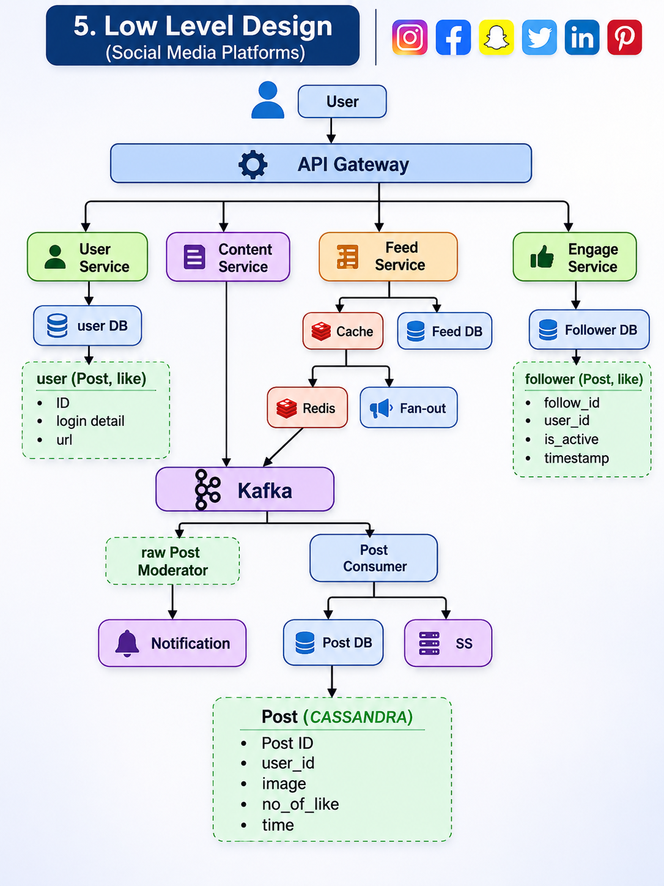

# Social Media Platform (Instagram / Facebook / Twitter / Snapchat / Pinterest)

System design for an image-first social media platform: signup/login,
image posts, follow/unfollow, a personalised feed, and likes. The design
is built for 10M DAU and is AP-leaning (availability over consistency).

## 1. Requirement Analysis

### 1A. Functional Requirements

-   User can **sign up / log in** (and log out).
-   User can **post an image**.
-   User can **follow / unfollow** other users.
-   User can view their **feed** (posts from people they follow) and a
    user **timeline** (a single user's posts).
-   User can **like** a post.

### 1B. Non-Functional Requirements

  Concern       Target
  ------------- ----------------------------------------------------------
  Scale         10M DAU, 10K+ posts
  CAP theorem   **Availability \>\>\>\>\> Consistency** (AP system)
  Latency       Feed loads fast; reads are far more frequent than writes

## 2. Identifying Entities

  Entity                    Description
  ------------------------- ---------------------------------------------------
  **User**                  A registered account (login details, profile URL)
  **Post**                  An image post made by a user
  **Follower / Followee**   A directed relationship: A follows B
  **Like**                  A user's like on a post

## 3. API Design

### 3A. Login / Register / Logout

-   `POST /v1/api/register` = {login}
-   `POST /v1/api/login` = {login}
-   `POST /v1/api/logout` = {logout}

### 3B. Post Image

-   `POST /v1/users/{userID}/upload` → Upload image

### 3C. Follow / Unfollow

-   `POST /v1/users/{userID}/interaction` → Follow/unfollow

### 3D. Like

-   `POST /v1/users/{userID}/posts/{POSTID}/like`

### 3E. Timeline / Feed

-   `GET /v1/posts/feed?limit={limit}&offset={offset}` → Pagination

## 4. High Level Design

``` text
user
  |
  v
API Gateway
  |
  v
Server (users, content, feed and engagement (like & follow))
  |
  v
Database (userDB, postDB, S3, feedDB, followerDB & likeDB)
```

## 5. Low Level Design



