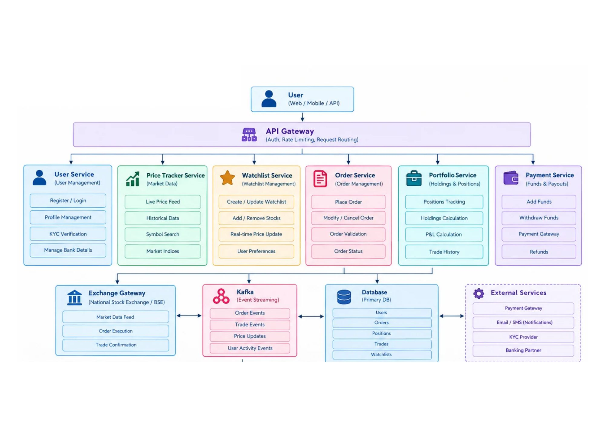

# Stock Trading Platform : System Design

A system design for a Zerodha/Robinhood-style stock trading platform that lets users register, view live prices, buy stocks, track a real-time watchlist, and see a portfolio dashboard, at the scale of 10M+ users with strong consistency and low latency.

## 1. Requirement Analysis

### 1A. Functional Requirements

| # | Requirement | Description |
|---|-------------|-------------|
| 1 | Login / Register | Users create an account and authenticate |
| 2 | View stock price | See the current price of a stock |
| 3 | Buy stock | Place an order to buy a stock |
| 4 | Watchlist (real-time) | Track chosen stocks with live price updates |
| 5 | Dashboard | See portfolio holdings, orders and P&L |

### 1B. Non-Functional Requirements

| Requirement | Target | Implication |
|-------------|--------|-------------|
| Scale | 10M+ users | Stateless services, horizontal scaling, sharded data |
| CAP theorem | **Consistency >>>> Availability** | Money and holdings can never be wrong; reject or retry rather than show or accept stale or conflicting data |
| Latency | Low | Cache hot data (prices), push updates over WebSocket, async non-critical work |

> **Why consistency over availability?** A user's balance, orders and holdings must be exactly correct. Double-spending cash or selling shares you do not own is far worse than a brief "try again" error. So for the order, payment and portfolio paths we choose **CP**.

## 2. Identifying Entities

| Entity | Purpose | Key Fields |
|--------|---------|-----------|
| **User** | Account holder | userId, name, email, passwordHash, kycStatus, createdAt |
| **Stock** | Tradable instrument | stockId, symbol, name, exchange, currentPrice, updatedAt |
| **Order** | A user's request to buy or sell | orderId, userId, stockId, side, quantity, price, type, status, idempotencyKey, createdAt |
| **Trade** | An executed (filled) order | tradeId, orderId, stockId, quantity, executedPrice, executedAt |
| **Portfolio** | User's current holdings | userId, stockId, quantity, avgBuyPrice |
| **Watchlist** | Stocks a user is tracking | userId, stockId, addedAt |

## 3. API Design

3A. LOGIN : POST /v1/auth/login {user ID} → Login
3B. VIEW PRICE OF STOCK : GET /v1/stocks/{stock ID} → List<Stock>: Pagination
3C. BUY THE STOCK : POST /v1/orders = {orderID} → Buy the stock
3D. PORTFOLIO : GET /v1/api/portfolio/{user ID} → Portfolio
3E. WATCHLIST : GET /v1/api/watchlist

## 4. High Level Design (HLD)

`User → API Gateway → Servers (User, Price Tracker, Watchlist, Order, Portfolio, Payment) → Databases (UserDB, PaymentDB, plus supporting stores)`

## 5. Low Level Design (LLD)

