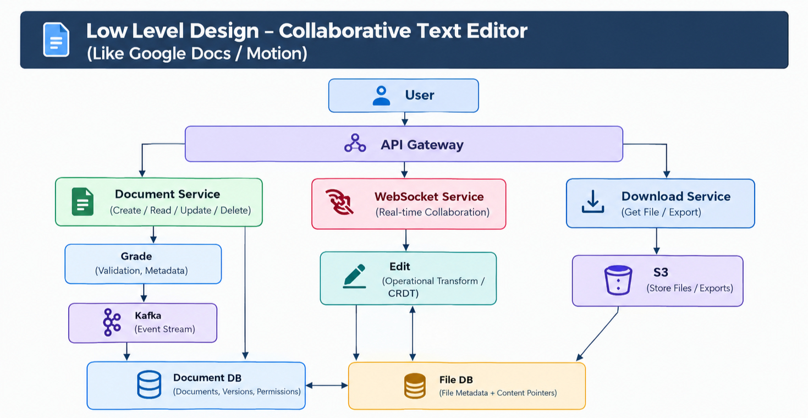

# Text Editor (Like Google Docs / Notion)

A system design for a collaborative text editor where users can create or upload `.txt` documents, see all their files, keep versions of each file, and download them. The design favours **availability over consistency** and is built to serve 10M+ users.


## 1. Requirement Analysis

### A. Functional Requirements

- Create / upload a `.txt` file
- See all created files
- Versioning of a file (view previous versions)
- Download the file

### B. Non-Functional Requirements

| Requirement | Target |
|---|---|
| Scale | 10M+ users, 10K+ documents |
| CAP theorem | Availability >>>>>>>>>> Consistency (AP system) |
| Latency | Low-latency edits and reads |
| Durability | A saved document or version is never lost |

## 2. Identifying Entities

| Entity | Description |
|---|---|
| **User** | A person who owns, edits, or views documents |
| **Document** | A text file with content, metadata, versions, and permissions |


## 3. API Design


### A. Create / Upload a Document

```
POST /v1/api/docs/create={docsID} -> create a .txt file 
```


### B. See All Files and File Details

```
GET /v1/api/docs              -> list all documents of the user
GET /v1/api/docs/{docsID}     -> details of one document
```

### C. Versions of a File

```
GET /v1/api/docs/{docsID}/version -> versions of file 
```

### D. Download the File

```
POST /v1/api/docs/{docsID}/download -> downloaded fille
```

### E. Real-time Editing (WebSocket)

```
WS /v1/ws/docs/{docsID} -> real time editing
```


## 5. High Level Design

```
User -> API Gateway -> Server (Documents: create & edit | Download) -> Database (DocumentDB & FileDB)
```


## 6. Low Level Design

\


