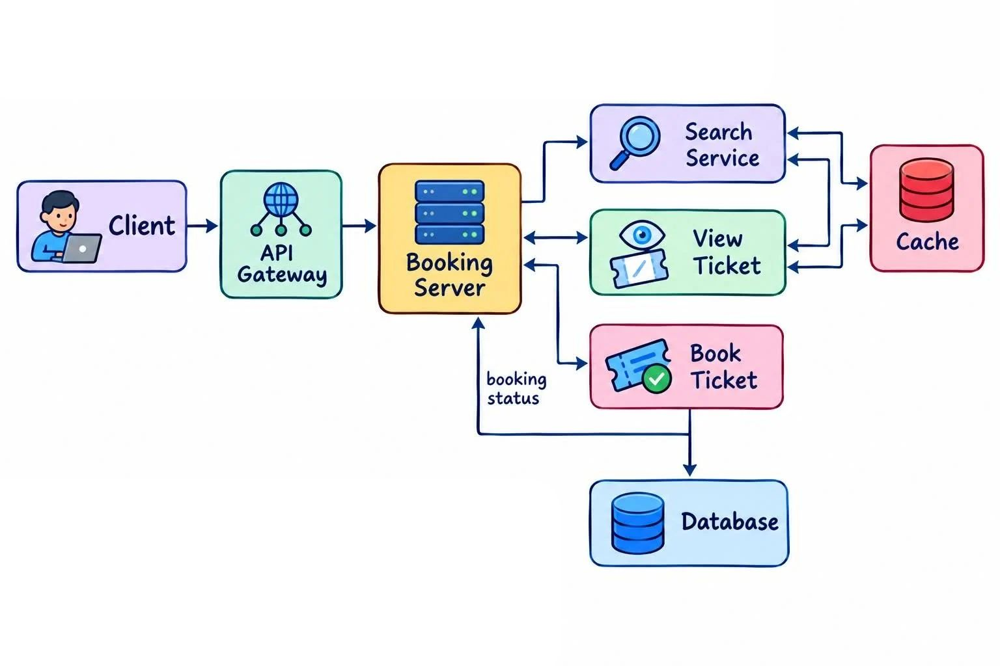

# Ticket Booking System Design

A system design for an event ticket booking platform: users can search for events, view event details, and book seats.


## 1. Requirement Analysis

### A. Functional Requirements
- Search for an event
- View the list of events
- Book a seat for an event

### B. Non-Functional Requirements
- **Scale:** 10M DAU (daily active users)
- **Availability:** the system should be highly available


## 2. Identifying Entities

- **User**
- **Event**
- **Ticket**


## 3. API Design

### A. Search
```http
GET /v1/search?query={search}&location={location}&date={date}
```
**Response:** `List<EventID>`

### B. View Event
```http
GET /v1/event/{eventID}
```
**Response:** event details

### C. Book

**Step 1: Reserve seats**
```http
POST /v1/booking/reserve
```
```json
{
  "seats": ["seat1", "seat2"]
}
```

**Step 2: Confirm booking**
```http
POST /v1/booking/confirm
```
```json
{
  "bookingID": "...",
  "paymentID": "..."
}
```

## 4. High-Level Design

```
User -> API Gateway -> Server (Search, View & Book) -> Database
```


## 5. Low-Level Design


