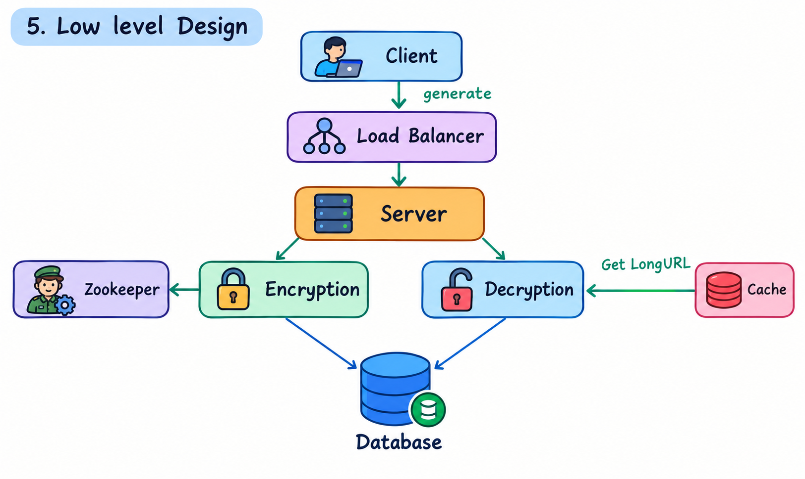

# TinyURL – System Design

A URL shortener that converts a long URL into a short one of the form `http://bit.ab/<6-chars>`.

```text
https://www.linkedin.com/in/saurabgyawalii
                    ↓
              http://bit.ab/aB3xY9
```


## 1. Requirement Analysis

### A. Functional Requirements

- **No login policy:** Anyone can use the service without creating an account.
- **Simple flow:** Paste a long URL and get a short URL.
- **No custom alias:** Short codes are always system-generated.
- **3-day expiry:** Every short URL expires 3 days after creation.

### B. Non-Functional Requirements

- **Low latency:** Fetching the long URL from a short URL must be fast, so the redirect feels instant.
- **Scale:** 1M monthly active users (MAU) / ~1M URLs.
- **Unique shortening:** Two different long URLs must never get the same short code.
- **High availability:** The service should keep working even if individual components fail.

## 2. Identifying Entities

| Entity | Description |
|---|---|
| **User** | Anyone using the service (anonymous, no login) |
| **Long URL** | The original URL submitted by the user |
| **Short URL** | The generated `bit.ab/<6-chars>` link that maps to a long URL |

## 3. API Design

### Create a short URL


## 4. High Level Design

```text
User  ──►  Server  ──►  Database
```

The user sends a long URL to the server, the server generates and stores the mapping in the database, and later resolves short codes back to long URLs.


## 5. Low Level Design


