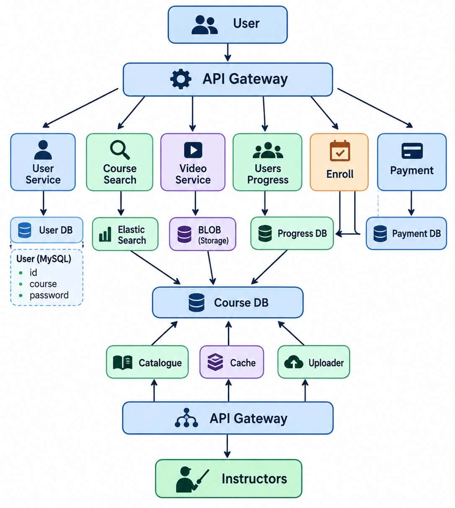

# Ed-Tech Platform: System Design

> An online learning platform (think Udemy / Coursera) designed for 100M+ users and 10K+ courses, where availability matters far more than strict consistency.


## 1. Requirement Analysis

### 1A. Functional Requirements

| # | Requirement | Description |
|---|-------------|-------------|
| 1 | Create account | A user can sign up and log in as a student or instructor |
| 2 | Browse courses | Search and filter courses by category, price, rating, level |
| 3 | Enroll | Students enroll in free or paid courses |
| 4 | Assessment system | Quizzes and assignments attached to a course, with scoring |
| 5 | Review system | Enrolled students can rate and review a course |
| 6 | Instructor onboarding | A user applies and gets verified as an instructor |
| 7 | Course creation | Instructors create, edit and publish courses (sections, lectures, videos) |

### 1B. Non-Functional Requirements

| Requirement | Target |
|-------------|--------|
| Scale | 100M+ users, 10K+ courses |
| CAP theorem | **Availability >>>>>> Consistency** (AP system) |

## 2. Identifying Entities

| Entity | Purpose | Key fields |
|--------|---------|-----------|
| **User** | Student or instructor account | `user_id`, `name`, `email`, `password_hash`, `role` |
| **Course** | A published unit of learning | `course_id`, `instructor_id`, `title`, `description`, `price`, `category`, `status`, `rating_avg` |
| **Payment** | Money movement for an enrollment | `payment_id`, `user_id`, `course_id`, `amount`, `status`, `idempotency_key` |
| **Review** | Rating and text on a course | `review_id`, `course_id`, `user_id`, `rating`, `comment` |


## 3. API Design

### 3A. Courses

| Method | Endpoint | Purpose |
|--------|----------|---------|
| `GET` | `/v1/courses?{query}` | Browse and search courses (filters, sort, pagination) |
| `GET` | `/v1/courses/{courseID}` | Course details (curriculum, instructor, rating) |
| `POST` | `/v1/instructor/{courseID}/publish` | Instructor publishes a course (state change) |

### 3B. Enroll

| Method | Endpoint | Purpose |
|--------|----------|---------|
| `POST` | `/v1/courses/{courseID}` | Enroll the logged-in student in a course |
| `GET` | `/me/enrollments` | List the logged-in student's enrollments |

### 3C. Progress

| Method | Endpoint | Purpose |
|--------|----------|---------|
| `POST` | `/v1/progress/events` | Send a progress event (video watched, lecture completed) |
| `GET` | `/v1/courses/{courseID}` | Fetch the student's progress for a course |


## 4. High Level Design

```
User -> Server -> DataBase
```


## 5. Low Level Design



